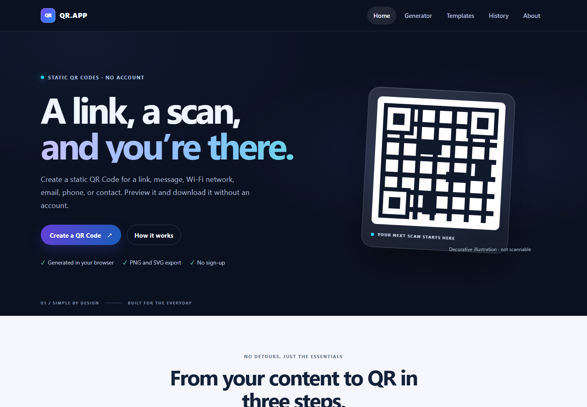
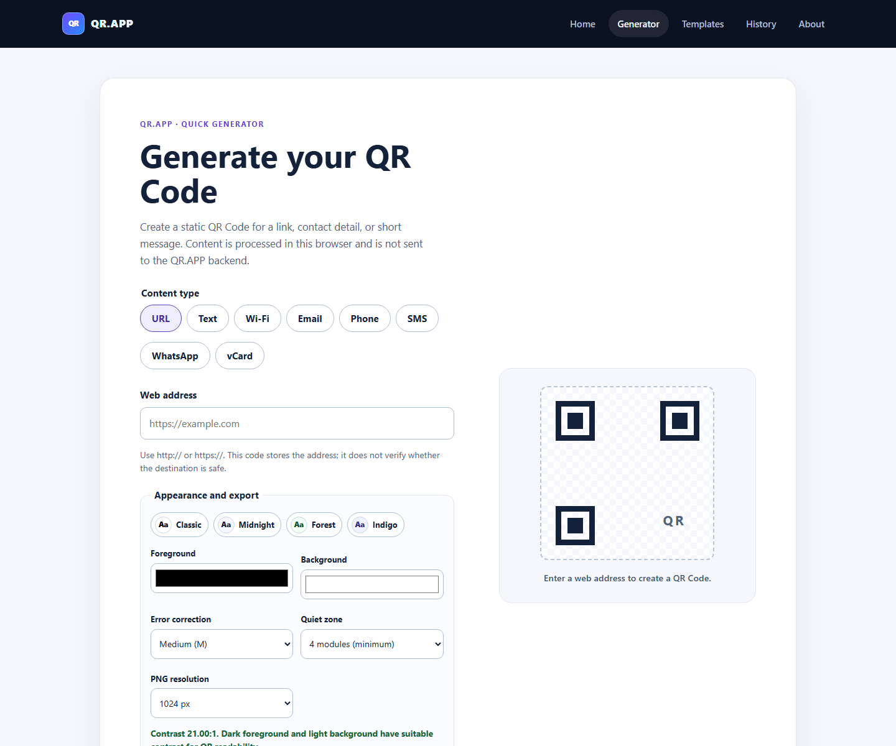
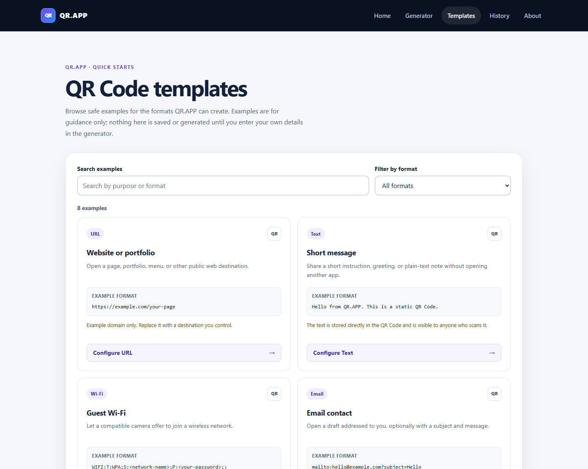
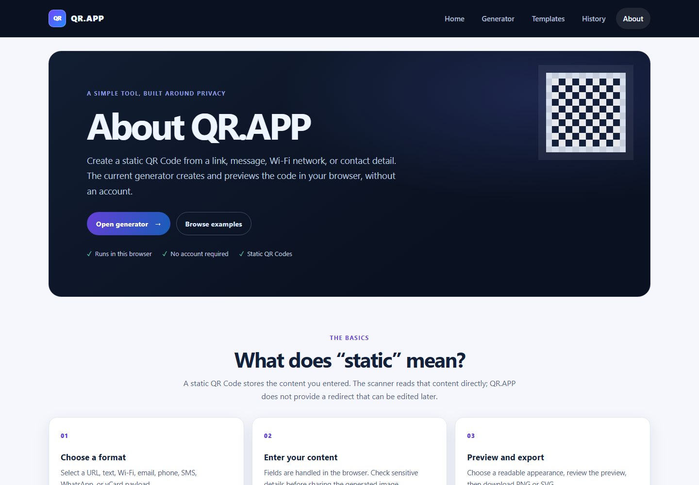

# QR.APP

QR.APP é um gerador de QR Codes estáticos, sem conta e com processamento local no navegador. Crie códigos para URL, texto, Wi-Fi, e-mail, telefone, SMS, WhatsApp e vCard; ajuste a aparência, confira a prévia e exporte PNG ou SVG.

> **Estado do projeto:** evolução em andamento na branch `feature/qr-app-2.0`. Ainda não há demonstração pública desta versão. O QR.APP 2.0 é um gerador client-side sem histórico de conteúdo no servidor.

## O que está disponível

- Oito formatos de conteúdo: URL, texto, Wi-Fi, e-mail, telefone, SMS, WhatsApp e vCard.
- Pré-visualização e geração no navegador com a biblioteca `qrcode`.
- Personalização de cores, margem, nível de correção de erros e dimensão do PNG.
- Verificação de contraste antes de gerar.
- Exportação PNG e SVG.
- Biblioteca de exemplos, sem pré-preencher ou salvar dados pessoais.
- Páginas responsivas Home, Generator, Templates e About.
- Sem cadastro e sem envio do payload do gerador ao backend.

## Prévia local

Capturas feitas no navegador local para esta branch. A arte ilustrativa da Home é decorativa e não representa um QR Code funcional.

| Home | Generator |
| --- | --- |
|  |  |

| Templates | About |
| --- | --- |
|  |  |

## Tecnologias

| Área | Tecnologias observadas |
| --- | --- |
| Frontend | React 19, TypeScript, Vite, React Router |
| Geração no navegador | `qrcode` |
| Backend legado (versão anterior) | Node.js, Express, TypeScript, Prisma, PostgreSQL |
| Geração/armazenamento da v2 | processados no navegador; sem backend ou persistência de payload |

## Executar localmente

Requisitos: Node.js 20.19+ ou 22.12+ e npm. O frontend v2 não depende de `.env`, backend, banco de dados ou credenciais Supabase. Siga [`LOCAL_DEVELOPMENT.md`](./LOCAL_DEVELOPMENT.md).

```powershell
# Frontend
cd C:\Users\multivac\Desktop\Git\qr.app\frontend
npm ci
npm run dev -- --host 127.0.0.1
```

Abra `http://127.0.0.1:5173`. Não compartilhe nem versione arquivos `.env`.

## Qualidade e comandos

Executados na pasta `frontend`:

```powershell
npm run lint
npm run build
```

O repositório ainda contém código e configuração de backend da versão anterior. O build desse backend não é necessário para executar a v2. Os manifests atuais não definem uma suíte automatizada de testes; lint e build do frontend não substituem testes de fluxo nem validação de leitura dos QR Codes exportados.

## Arquitetura em resumo

```text
Browser
  ├─ React + Vite: rotas e interface
  ├─ features/generator: validação, serialização, contraste e QR
  └─ `qrcode`: criação local de PNG/SVG
```

A interface da v2 não tem tela de histórico nem chama endpoints de conteúdo. Nesta branch, `backend/src/app.ts` monta somente `/healthz`; os arquivos antigos de API ainda estão no repositório e também estão preservados em `legacy/qr-app-v1`. A produção ligada à `main` ainda não recebeu essa alteração.

## Privacidade e limitações

- O conteúdo do gerador é convertido em QR Code no navegador e não é enviado à API por esse fluxo.
- QR Codes são estáticos: o conteúdo fica no próprio código e não pode ser editado ou revogado após alguém salvar a imagem.
- Wi-Fi QR Codes carregam SSID e, quando informada, senha em texto recuperável por leitores compatíveis. Compartilhe com cuidado.
- URLs são codificadas como destino; o gerador não verifica a segurança do site.
- A leitura depende também do tamanho impresso, contraste, quiet zone, câmera e leitor. Valide com dispositivos reais antes de imprimir em escala.
- A versão 2.0 não persiste QR Codes em histórico remoto.
- Localização e eventos não fazem parte dos formatos implementados atualmente.

## Estrutura do repositório

- `frontend/src/features/generator/` — tipos, validação, serialização e geração dos QR Codes.
- `frontend/src/pages/` — páginas e componentes da interface.
- `frontend/src/css/` — estilos globais e por página.
- `backend/src/` e `backend/prisma/` — código e schema da API anterior; na v2, as rotas de conteúdo não são montadas pelo app.
- `concepts/` — referências e especificações de interface fornecidas para o projeto.
- [`LOCAL_DEVELOPMENT.md`](./LOCAL_DEVELOPMENT.md) — configuração e operação local.
- [`docs/PORTFOLIO_CASE_STUDY.md`](./docs/PORTFOLIO_CASE_STUDY.md) — estudo de caso com estado e limites verificados.

## Publicação, licença e contribuição

O destino proposto para a v2 é o frontend estático na Vercel, sem `VITE_API_URL`, Render ou Supabase. A publicação desta branch e a desativação de recursos remotos não foram realizadas. A produção atual da `main` permanece intacta; consulte [`DEPLOYMENT.md`](./DEPLOYMENT.md) antes de promover a v2. Não versionar segredos.

A licença ainda precisa ser definida pelo proprietário antes de autorizar reutilização.

Contribuições podem ser propostas por branch e pull request depois que o fluxo de revisão for definido. Não inclua dados pessoais, QR Codes reais, chaves ou arquivos `.env` em issues, screenshots ou commits.
